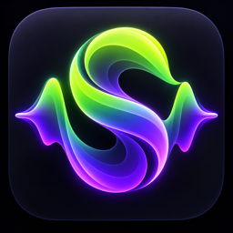
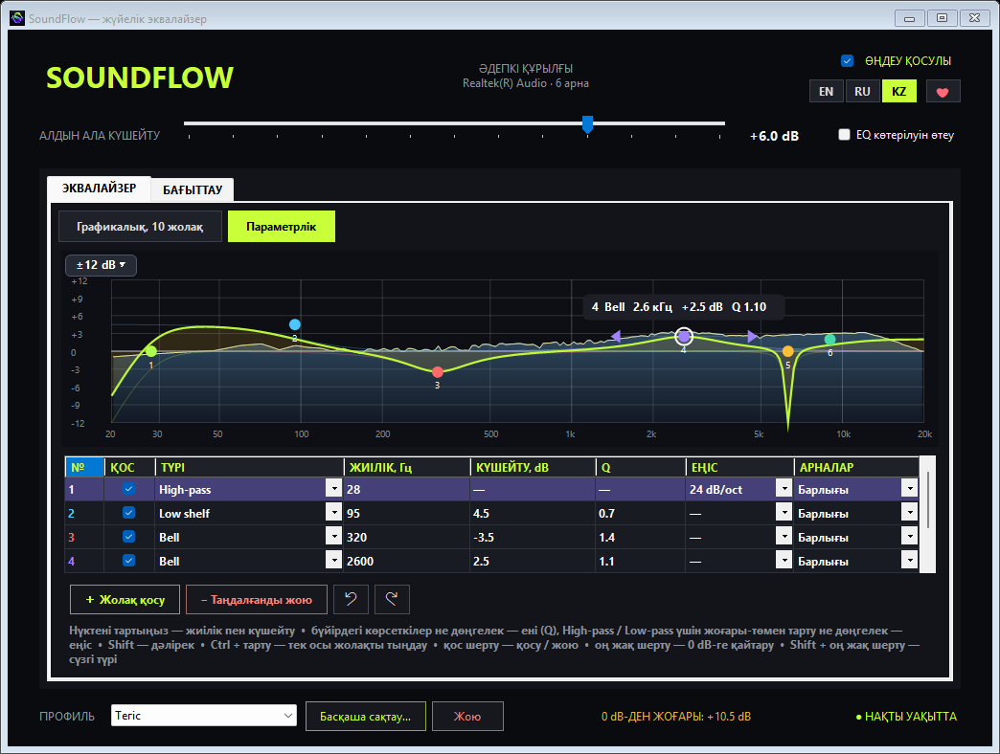
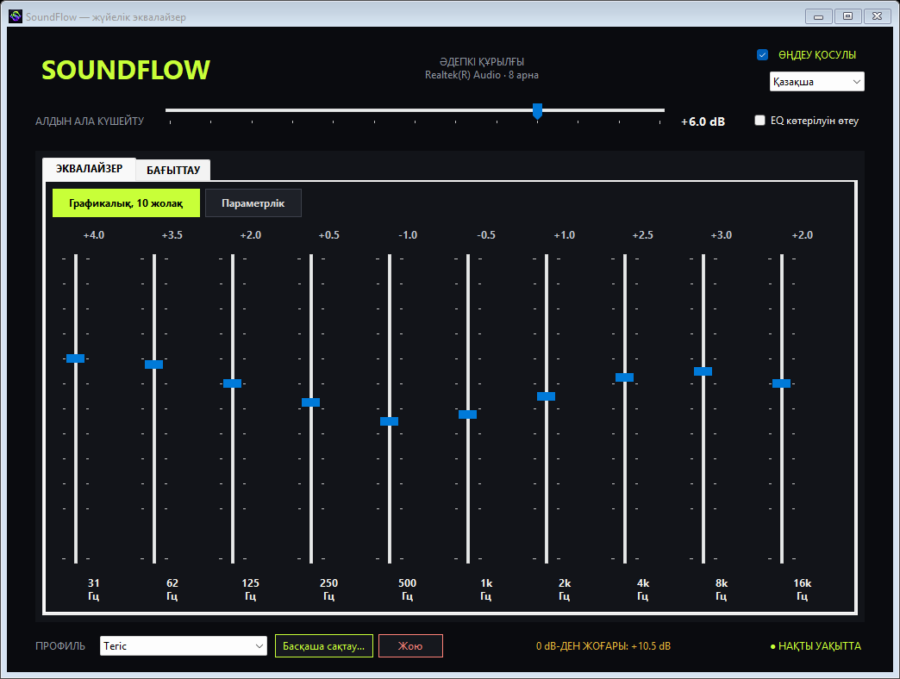
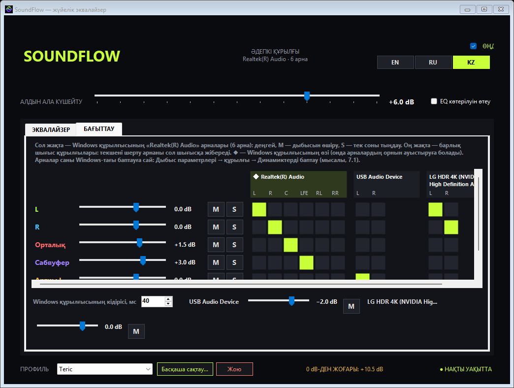

<a href="README.md">English</a> · <a href="README.ru.md">Русский</a> · <b>Қазақша</b>

<h1 align="center">SoundFlow</h1>

<b>Windows үшін тегін жүйелік эквалайзер және дыбыс бағыттағышы.</b> 
Түнгі дыбыс деңгейінде қатты әрі анық фильмдер, параметрлік эквалайзер және кез келген арнаны кез келген дыбыс картасына жіберу — виртуалды кабельсіз.

Windows 10/11 · тегін · ашық бастапқы код (MIT) · English / Русский / Қазақша 
 
<a href="https://github.com/ushtozhish/soundflow/releases/latest"><b>⬇ Орнатушыны жүктеп алу</b></a>  

> Скриншоттар әр өзгерісте нақты интерфейстен автоматты түрде түсіріледі (GitHub Actions, демо-деректер: құрылғы атаулары мен баптаулар — мысалдар).

## Мазмұны

- [Неге SoundFlow](#неге-soundflow)
- [Бағдарламаға шолу](#бағдарламаға-шолу): [Алдын ала күшейту](#1-алдын-ала-күшейту) · [Параметрлік эквалайзер](#2-параметрлік-эквалайзер) · [Графикалық эквалайзер](#3-графикалық-эквалайзер) · [Бағыттау](#4-бағыттау) · [Профильдер, науа, тіл](#5-профильдер-науа-тіл)
- [Орнату](#орнату) · [Қалай жұмыс істейді](#қалай-жұмыс-істейді) · [Шектеулер](#шектеулер) · [Бастапқы кодтан құрастыру](#бастапқы-кодтан-құрастыру) · [Бауырша қолда](#️-бауырша-қолда) · [Лицензия](#лицензия)

## Неге SoundFlow

- **Шытырлаусыз түнгі режим.** Алдын ала күшейтуді +12 dB-ге дейін көтеріп, Windows дыбысын төмен қалдырыңыз: тыныш көріністер анық естіледі, ештеңе бұрмаланбайды. Жүгірткі сіз қойған жерде қалады, компьютерді қайта іске қосқаннан кейін де.
- **Тірі спектр үстіндегі нағыз параметрлік эквалайзер.** Қисықтағы нүктелерді тартқанда, ойнап тұрған дыбыстың шыңдары қалай қозғалатынын көресіз; енін дөңгелекпен өзгертіңіз, бір жолақты бөлек тыңдаңыз, жиілікті тыныштыққа дейін кесіңіз.
- **Микшердегідей бағыттау.** Негізгі картаның кез келген арнасын басқа картаның (USB, HDMI…) кез келген арнасына матрицадағы текшелерді шерту арқылы жіберіңіз. VB-Cable мен қосымша драйверсіз.
- **Ештеңе мазаламайды.** Сынақ мерзімі, қалқымалы терезелер және іске қосу кезінде күту жоқ. Windows-пен бірге тыныш, науада іске қосылады.

## Бағдарламаға шолу

### 1. Алдын ала күшейту

Жоғарғы жүгірткі бүкіл дыбысты көтереді не төмендетеді (−12…+12 dB). Оң жақ шерту оны 0 dB-ге қайтарады.
**EQ көтерілуін өтеу** — қосулы болса, SoundFlow шығысты эквалайзер қанша көтерсе, сонша азайтады (мысалы, баста +6 dB → шығыста −6 dB), ең қатты жерлер қаттырақ болмайды. Жүгірткінің өзі ешқашан жылжымайды. Әдепкі бойынша өшірулі.
Төменгі жол қорытынды деңгейдің 0 dB-ден қаншалықты жоғары не төмен екенін көрсетеді.

### 2. Параметрлік эквалайзер

**Эквалайзер** қойындысы → **Параметрлік**.

| Әрекет | Не болады |
|---|---|
| Нүктені тарту | жиілік пен күшейту |
| Бүйірдегі көрсеткілер / тінтуір дөңгелегі | жолақ ені (Q); High-pass / Low-pass үшін — еңіс |
| High-pass / Low-pass нүктесін жоғары не төмен тарту | жұмсағырақ / тіктеу кесу (12–96 dB/окт) |
| Shift + тарту / дөңгелек | дәл баптау |
| Ctrl + тарту | тек осы жолақты тыңдау (соло) |
| Графикті қос шерту | жолақ қосу |
| Нүктені қос шерту / Delete | жолақты жою |
| Нүктені оң жақ шерту | күшейтуді 0 dB-ге қайтару |
| Shift + оң жақ шерту | сүзгі түрі |
| ← → ↑ ↓ | жиілікті / күшейтуді жылжыту |
| Ctrl+Z / Ctrl+Y | болдырмау / қайтару |
| `±12 dB ▾` батырмасы (жоғарғы сол жақта) | график шкаласы ±12 / ±24 / ±48 dB |

Қисықтың артында компьютер ойнатып жатқан дыбыстың **тірі спектрі** жүреді: көк аймақ — ағымдағы деңгей, ашық сызық шыңдарды бір секунд ұстап, сосын баяу түсіреді — қай жиіліктер шығып тұрғанын және түзетулеріңіз оларға қалай әсер ететінін көресіз.

Сүзгі түрлері (атаулары барлық тілде ағылшынша): Bell, Low shelf, High shelf, High-pass және Low-pass (12–96 dB/окт, кесу жиілігінде өркешсіз), Notch, Band-pass. Жолақты −60 dB-ге дейін түсіруге болады; **Notch** бір жиілікті толығымен өшіреді (гуіл, шиқыл). Кез келген жолақты бір арнамен шектеуге болады (мысалы, тек сабвуфер). График астындағы кесте — нақты сандар үшін.

### 3. Графикалық эквалайзер

31 Гц-тен 16 кГц-ке дейінгі он классикалық жолақ, ±12 dB. Жүгірткіні оң жақ шерту оны тазартады.

### 4. Бағыттау

- **Сол жақта** — Windows-та таңдалған құрылғының арналары: әрқайсысының деңгейі, **M** (дыбысын өшіру) және **S** (соло).
- **Оң жақта** — компьютердің барлық шығыс құрылғылары, әрқайсысының өз арналары. **Текшені шерту** сол жақтағы арнаны осы шығысқа жібереді.
- **◆ Windows құрылғысының өзі** қалыпты ойнатуды диагональ ретінде көрсетеді. Арналардың орнын ауыстыру үшін оны өзгертіңіз (мысалы, орталықты сол жақ динамикке). Мұны Equalizer APO кідіріссіз орындайды.
- **Басқа карталар** SoundFlow жасаған көшірмені алады. Көшірме әр картаның өз сағатына бейімделеді, сондықтан уақыт өте ажырамайды және шытырламайды. Құрылғы атауын оң жақ шерту оның бағыттарын тазартады.
- Төменде: әр шығыстың деңгейі мен **M**, және **Windows құрылғысының кідірісі** — көшірмелер 30–60 мс кеш жетеді, бәрі бірге дыбыстау үшін негізгі картаны да сонша кідіртіңіз.

Екіден көп арнаны тарату үшін негізгі картаны Windows-та 5.1 немесе 7.1 режиміне ауыстырыңыз (Дыбыс параметрлері → құрылғы → Динамиктерді баптау), тек екі динамик қосылған болса да. Сонда көлемді дыбысты фильмдер барлық арналарымен келеді және оларды таратуға болады.

### 5. Профильдер, науа, тіл

- **Профильдер**: кірістірілген және өзіңіздікі (**Басқаша сақтау…**). Профильдер алдын ала күшейтуді ешқашан өзгертпейді.
- Тіл батырмаларының жанындағы ❤ (және науа мәзіріндегі) [қолдау бетін](https://ushtozhish.github.io/support/) ашады.
- Терезені жапқанда SoundFlow науада жұмысын жалғастырады. Науа мәзірі: қосу/өшіру, Windows-пен бірге іске қосу, баптаулар мен журнал қалтасы, шығу.
- Тіл: EN | RU | KZ батырмалары (жоғарғы оң жақта). Алғашқы іске қосуда — Windows тілі бойынша.

## Орнату

1. `SoundFlow-Setup.exe` файлын [Releases](https://github.com/ushtozhish/soundflow/releases/latest) бөлімінен жүктеп алып, іске қосыңыз.
2. Equalizer APO әлі орнатылмаған болса, орнатушы оны орнатады: оның терезесінде ойнату құрылғыңызды белгілеп, компьютерді қайта іске қосыңыз.
3. Жаңарту: жаңа орнатушыны ескісінің үстінен іске қосыңыз, баптаулар сақталады.

Жою — Windows-тың «Бағдарламаларды орнату және жою» арқылы: SoundFlow баптаулары Equalizer APO-дан алынады, APO өзі қалады (оны бөлек жоюға болады).

## Қалай жұмыс істейді

- Дыбысты [Equalizer APO](https://sourceforge.net/projects/equalizerapo/) — жүйелік дыбыс эффектісі өңдейді. SoundFlow `C:\Program Files\EqualizerAPO\config\soundflow.txt` файлын жазады, APO оны бірден қолданады. Орнатушы қарапайым пайдаланушыға тек осы файлға жазу құқығын береді, сондықтан SoundFlow әкімші құқығынсыз жұмыс істейді.
- Басқа карталарға бағыттау: Windows құрылғысын түсіру (WASAPI loopback) → арналар матрицасы → әр картаның сағатына бейімделетін ресемплер → WASAPI шығысы.
- Баптаулар: `%AppData%\SoundFlow\settings.json` (бірден, сақтық көшірмесімен сақталады). Журнал: `%AppData%\SoundFlow\soundflow.log`.

## Шектеулер

- Тек Windows 10/11 x64; Equalizer APO қажет (автоматты түрде орнатылады).
- Басқа карталардағы көшірмелер SoundFlow іске қосулы кезде ғана дыбыстайды (ол Windows-пен бірге іске қосылады).
- Негізгі картаның эквалайзері көшірмеге түсетін-түспейтіні дыбыс драйверіне байланысты.
- Көп арналы шығыс картаның өзінен қажет; құрылғы Windows-та стерео режимде тұрса, Windows бәрін екі арнаға біріктіреді.

## Бастапқы кодтан құрастыру

[.NET 10 SDK](https://dotnet.microsoft.com/download) (x64) орнатып, `build-installer.cmd` іске қосыңыз, нәтижесі — `SoundFlow-Setup.exe`. `main` тармағындағы әр коммит GitHub Actions-та құрастырылады; `vX.Y.Z` тегі релиз жариялайды.

## ❤️ Бауырша қолда

> [!TIP]
> Бағдарлама тегін әрі ашық кодты. Пайдасы тисе, қалағаныңша қолда — бұл ерікті әрі өтеусіз сыйлық, оның орнына ештеңе берілмейді, бағдарлама бәріне тегін болып қала береді.
>
> - 🇰🇿 **Kaspi:** `4400 4303 6234 6964` (аударар алдында атын тексер: Артём В.)
> - 📱 **«Нөмірді көшіру» батырмасы бар бет:** https://ushtozhish.github.io/support/

## Лицензия

SoundFlow MIT лицензиясымен таратылады, [LICENSE](LICENSE) қараңыз. Үшінші тарап компоненттері — [THIRD-PARTY-NOTICES.md](THIRD-PARTY-NOTICES.md); Equalizer APO — GPL-2.0.
