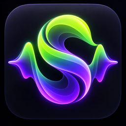
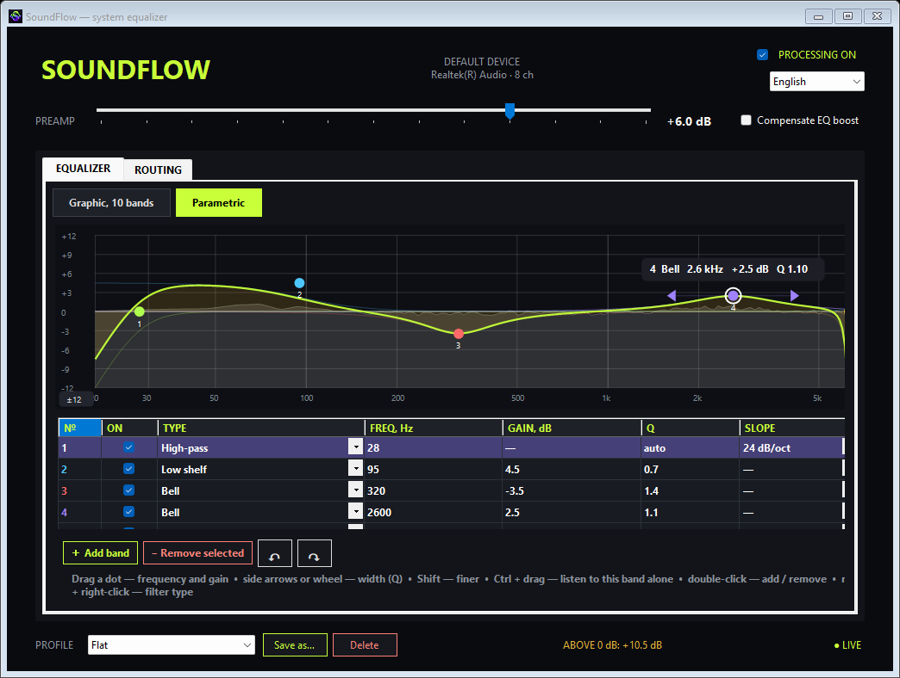
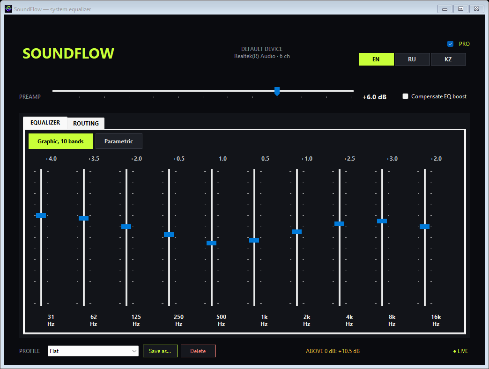
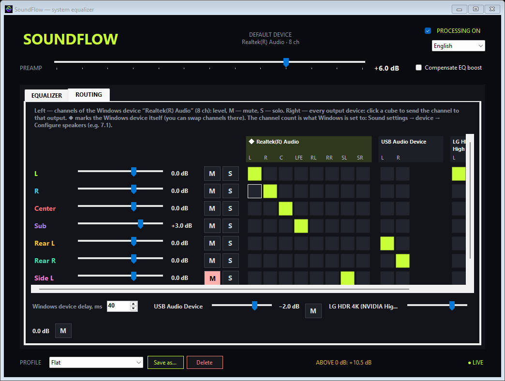

<b>English</b> · <a href="README.ru.md">Русский</a> · <a href="README.kk.md">Қазақша</a>

<h1 align="center">SoundFlow</h1>

<b>A free system-wide equalizer and audio router for Windows.</b> 
Make films loud and clear at night volume, shape the sound with a parametric EQ, and send any channel to any sound card — without virtual cables.

Windows 10/11 · free · open source (MIT) · English / Русский / Қазақша 
 
<a href="https://github.com/ushtozhish/soundflow/releases/latest"><b>⬇ Download the installer</b></a>

> Screenshots are taken automatically from the real interface on every change (GitHub Actions, demo data: the device names and settings are examples).

## Contents

- [Why SoundFlow](#why-soundflow)
- [Tour of the app](#tour-of-the-app): [Preamp](#1-preamp) · [Parametric EQ](#2-parametric-eq) · [Graphic EQ](#3-graphic-eq) · [Routing](#4-routing) · [Profiles, tray, language](#5-profiles-tray-language)
- [Installation](#installation) · [How it works](#how-it-works) · [Limitations](#limitations) · [Building from source](#building-from-source) · [Support the dev](#️-support-the-dev) · [License](#license)

## Why SoundFlow

- **Night mode without crackle.** Raise the preamp up to +12 dB and keep Windows volume low: quiet scenes become clear, nothing distorts. The slider stays exactly where you put it — after restarts too.
- **A real parametric EQ.** Drag points on the curve, change the width with the wheel, listen to one band alone, cut a frequency down to silence.
- **Routing like a mixer.** Send any channel of your main card to any channel of another card (USB, HDMI…) by clicking cubes in a matrix. No VB-Cable, no extra drivers.
- **Nothing nags.** No trial, no pop-ups, no waiting at start. It starts with Windows quietly in the tray.

## Tour of the app

### 1. Preamp

The slider at the top raises or lowers the whole sound (−12…+12 dB). Right-click it to return to 0 dB.
**Compensate EQ boost** — when on, SoundFlow lowers the output by as much as the EQ raises it (e.g. +6 dB of bass → −6 dB at the output), so the loudest parts don't get louder. The slider itself never moves. Off by default.
The line at the bottom shows how far the result is above or below 0 dB.

### 2. Parametric EQ

**Equalizer** tab → **Parametric**.

| Action | What happens |
|---|---|
| Drag a dot | frequency and gain |
| Side arrows / mouse wheel | band width (Q) |
| Shift + drag / wheel | fine adjustment |
| Ctrl + drag | listen to this band alone (solo) |
| Double-click the graph | add a band |
| Double-click a dot / Delete | remove the band |
| Right-click a dot | gain back to 0 dB |
| Shift + right-click | filter type |
| ← → ↑ ↓ | nudge frequency / gain |
| Ctrl+Z / Ctrl+Y | undo / redo |
| `±12` button (bottom left) | graph scale ±12 / ±24 / ±48 dB |

Filter types: bell, low/high shelf, high-pass and low-pass with 12–48 dB/oct slopes, notch, band-pass. A band can go down to −60 dB; **notch** silences a single frequency completely (hum, whine). Every band can be limited to one channel (e.g. only the subwoofer). The table under the graph gives exact numbers.

### 3. Graphic EQ

Ten classic bands from 31 Hz to 16 kHz, ±12 dB. Right-click a slider to reset it.

### 4. Routing

- **Left** — the channels of the device selected in Windows: level, **M** (mute) and **S** (solo) for each.
- **Right** — every output device of the computer, each with its own channels. **Click a cube** to send the channel on the left to that output.
- **◆ The Windows device itself** shows its normal playback as a diagonal. Change it to swap channels (e.g. center into the left speaker) — done inside Equalizer APO, zero latency.
- **Other cards** get a copy made by SoundFlow. The copy follows each card's own clock, so it doesn't drift or click over time. Right-click a device name to clear its routes.
- At the bottom: level and **M** for each output, and **Windows device delay** — copies arrive 30–60 ms later, delay the main card by the same to line everything up.

To spread more than two channels, set the main card to 5.1 or 7.1 in Windows (Sound settings → device → Configure speakers) — even if only two speakers are connected. Surround films then arrive with all channels and you can distribute them.

### 5. Profiles, tray, language

- **Profiles**: built-in presets and your own (**Save as…**). Profiles never change the preamp.
- Closing the window keeps SoundFlow running in the tray. Tray menu: on/off, start with Windows, settings and log folder, exit.
- Language: EN | RU | KZ buttons (top right). On first start it follows the Windows language.

## Installation

1. Download `SoundFlow-Setup.exe` from [Releases](https://github.com/ushtozhish/soundflow/releases/latest) and run it.
2. If Equalizer APO isn't installed yet, the setup installs it: tick your playback device in its window and restart the computer.
3. Updating: run the new installer over the old one, your settings are kept.

Uninstall via Windows "Apps & features": SoundFlow's settings are removed from Equalizer APO; APO itself stays (remove it separately if you want).

## How it works

- Sound processing is done by [Equalizer APO](https://sourceforge.net/projects/equalizerapo/), a system audio effect. SoundFlow writes `C:\Program Files\EqualizerAPO\config\soundflow.txt` and APO applies it instantly. The installer lets normal users write only that file, so SoundFlow runs without admin rights.
- Routing to other cards: WASAPI loopback capture of the Windows device → channel matrix → adaptive resampler that follows each output card's clock → WASAPI output.
- Settings: `%AppData%\SoundFlow\settings.json` (saved immediately, with a backup copy). Log: `%AppData%\SoundFlow\soundflow.log`.

| File | Purpose |
|---|---|
| `SoundFlow.App/MainForm.cs` | window, profiles, undo, tray |
| `SoundFlow.App/ParametricGraph.cs` | interactive EQ graph |
| `SoundFlow.App/Router.cs` | routing engine and cube matrix |
| `SoundFlow.App/Apo.cs` | Equalizer APO config, filter math |
| `SoundFlow.App/Audio.cs` | default device, spectrum analyzer |
| `SoundFlow.App/Settings.cs` | settings, log, languages |
| `SoundFlow.Setup/Program.cs` | installer |

## Limitations

- Windows 10/11 x64 only; needs Equalizer APO (installed automatically).
- Copies on other cards play only while SoundFlow is running (it starts with Windows).
- Whether a copy includes the EQ of the main card depends on the sound driver.
- Physical multichannel output needs a card that supports it; Windows downmixes to stereo if the device is set to stereo.

## Building from source

Install the [.NET 10 SDK](https://dotnet.microsoft.com/download) (x64) and run `build-installer.cmd`; the result is `SoundFlow-Setup.exe`. Every commit to `main` is built by GitHub Actions; a `vX.Y.Z` tag publishes a release.

## ❤️ Support the dev

Free and open source. If it helped you, chip in what you like —
a voluntary gift, nothing in return, the tool stays free for everyone.

- 🇰🇿 **Kaspi:** `4400 4303 6234 6964` (Artem V. — check the name before sending)
- 📱 **Page with a copy button:** https://ushtozhish.github.io/support/

> 🇷🇺 **Поддержи по-братски:** Kaspi `4400 4303 6234 6964` (проверь имя: Артём В.). Добровольно и безвозмездно.

## License

SoundFlow is MIT-licensed, see [LICENSE](LICENSE). Bundled third-party components are listed in [THIRD-PARTY-NOTICES.md](THIRD-PARTY-NOTICES.md); Equalizer APO is GPL-2.0.
