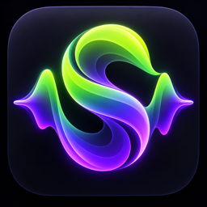
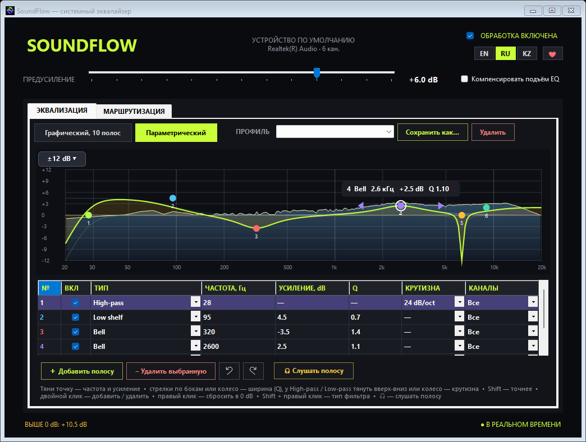
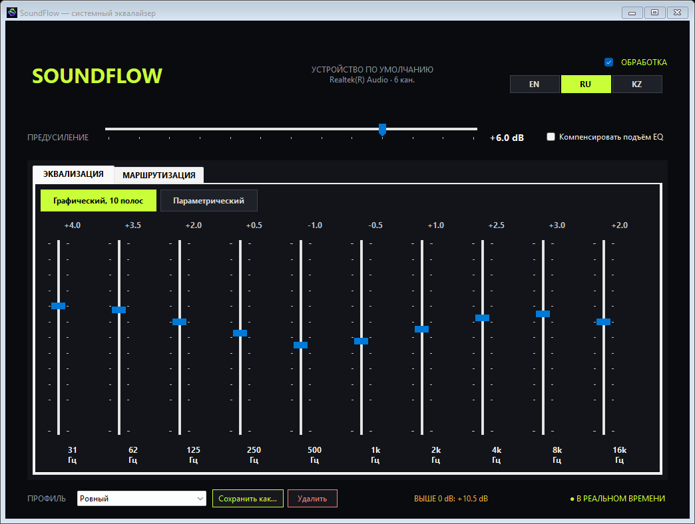
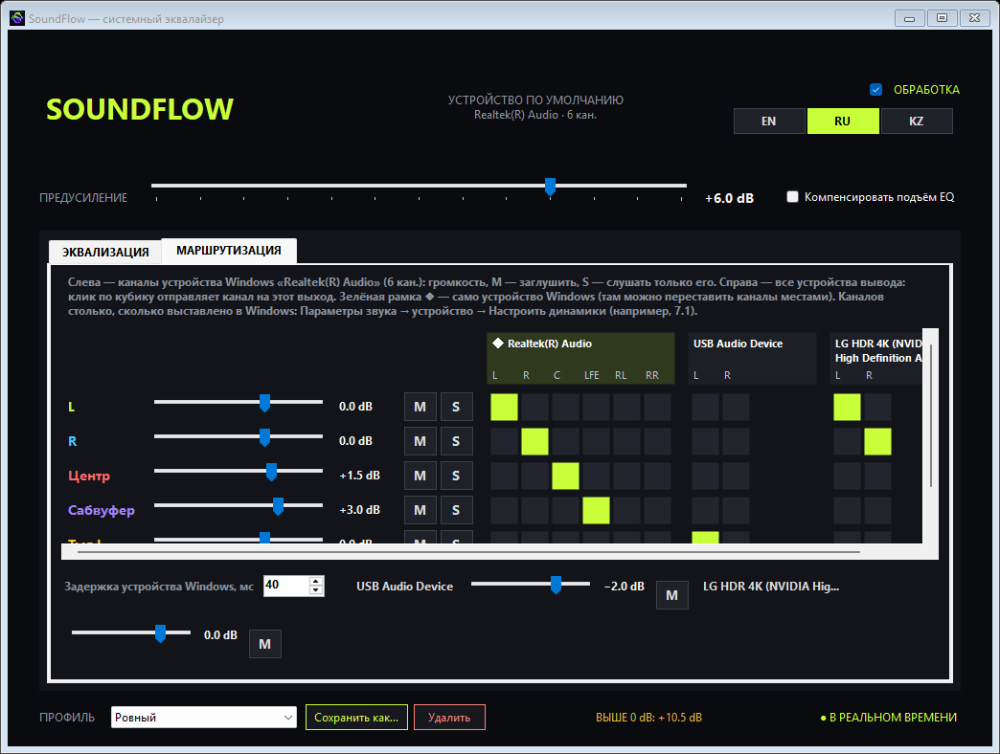

<a href="README.md">English</a> · <b>Русский</b> · <a href="README.kk.md">Қазақша</a>

<h1 align="center">SoundFlow</h1>

<b>Бесплатный системный эквалайзер и маршрутизатор звука для Windows.</b> 
Громкие и разборчивые фильмы на ночной громкости, параметрический эквалайзер и отправка любого канала на любую звуковую карту — без виртуальных кабелей.

Windows 10/11 · бесплатно · открытый код (MIT) · English / Русский / Қазақша 
 
<a href="https://github.com/ushtozhish/soundflow/releases/latest"><b>⬇ Скачать установщик</b></a>

> Скриншоты снимаются автоматически с настоящего интерфейса при каждом изменении (GitHub Actions, демо-данные: названия устройств и настройки — примеры).

## Содержание

- [Зачем SoundFlow](#зачем-soundflow)
- [Обзор программы](#обзор-программы): [Предусиление](#1-предусиление) · [Параметрический эквалайзер](#2-параметрический-эквалайзер) · [Графический эквалайзер](#3-графический-эквалайзер) · [Маршрутизация](#4-маршрутизация) · [Профили, трей, язык](#5-профили-трей-язык)
- [Установка](#установка) · [Как это работает](#как-это-работает) · [Ограничения](#ограничения) · [Сборка из исходников](#сборка-из-исходников) · [Поддержи по-братски](#️-поддержи-по-братски) · [Лицензия](#лицензия)

## Зачем SoundFlow

- **Ночной режим без треска.** Поднимите предусиление до +12 dB, а громкость Windows оставьте низкой: тихие сцены становятся разборчивыми, ничего не искажается. Ползунок остаётся ровно там, где вы его поставили, и после перезагрузки тоже.
- **Настоящий параметрический эквалайзер.** Тяните точки на кривой, меняйте ширину колесом, слушайте одну полосу отдельно, вырезайте частоту до тишины.
- **Маршрутизация как в микшере.** Любой канал основной карты — на любой канал другой карты (USB, HDMI…) кликом по кубикам в матрице. Без VB-Cable и дополнительных драйверов.
- **Ничего не навязывает.** Нет пробного периода, всплывающих окон и ожидания при запуске. Стартует вместе с Windows, тихо, в трей.

## Обзор программы

### 1. Предусиление

Ползунок вверху поднимает или опускает весь звук (−12…+12 dB). Правый клик возвращает его в 0 dB.
**Компенсировать подъём EQ** — если включено, SoundFlow убавляет выход на столько, на сколько эквалайзер поднимает звук (например, +6 dB на басу → −6 dB на выходе), и самые громкие места не становятся громче. Сам ползунок никогда не двигается. По умолчанию выключено.
Строка внизу показывает, насколько итог выше или ниже 0 dB.

### 2. Параметрический эквалайзер

Вкладка **Эквализация** → **Параметрический**.

| Действие | Что происходит |
|---|---|
| Тянуть точку | частота и усиление |
| Стрелки по бокам / колесо мыши | ширина полосы (Q) |
| Shift + тянуть / колесо | точная подстройка |
| Ctrl + тянуть | слушать только эту полосу (соло) |
| Двойной клик по графику | добавить полосу |
| Двойной клик по точке / Delete | удалить полосу |
| Правый клик по точке | усиление в 0 dB |
| Shift + правый клик | тип фильтра |
| ← → ↑ ↓ | сдвиг частоты / усиления |
| Ctrl+Z / Ctrl+Y | отменить / вернуть |
| Кнопка `±12` (внизу слева) | шкала графика ±12 / ±24 / ±48 dB |

Типы фильтров: колокол, низкая и высокая полка, срезы низов и верхов с крутизной 12–48 dB/окт, режекция, полосовой. Полосу можно опустить до −60 dB; **режекция** полностью глушит одну частоту (гул, писк). Любую полосу можно ограничить одним каналом (например, только сабвуфером). Таблица под графиком — для точных чисел.

### 3. Графический эквалайзер

Десять классических полос от 31 Гц до 16 кГц, ±12 dB. Правый клик по ползунку сбрасывает его.

### 4. Маршрутизация

- **Слева** — каналы устройства, выбранного в Windows: у каждого громкость, **M** (mute) и **S** (solo).
- **Справа** — все устройства вывода компьютера, у каждого свои каналы. **Клик по кубику** отправляет канал слева на этот выход.
- **◆ Само устройство Windows** показывает обычное воспроизведение диагональю. Измените её, чтобы переставить каналы (например, центр — в левую колонку). Это делает Equalizer APO, без задержки.
- **Другие карты** получают копию, которую делает SoundFlow. Копия подстраивается под часы каждой карты, поэтому со временем не расходится и не щёлкает. Правый клик по названию устройства убирает его маршруты.
- Внизу: громкость и **M** для каждого выхода и **задержка устройства Windows** — копии приходят на 30–60 мс позже, задержите основную карту на столько же, чтобы всё звучало вместе.

Чтобы раскладывать больше двух каналов, переключите основную карту в Windows на 5.1 или 7.1 (Параметры звука → устройство → Настроить динамики), даже если подключены только две колонки. Тогда фильмы с объёмным звуком приходят со всеми каналами, и их можно раздать.

### 5. Профили, трей, язык

- **Профили**: встроенные и свои (**Сохранить как…**). Профили никогда не меняют предусиление.
- Закрытие окна оставляет SoundFlow работать в трее. Меню трея: вкл/выкл, запуск с Windows, папка с настройками и журналом, выход.
- Язык: кнопки EN | RU | KZ (вверху справа). При первом запуске — по языку Windows.

## Установка

1. Скачайте `SoundFlow-Setup.exe` в [Releases](https://github.com/ushtozhish/soundflow/releases/latest) и запустите.
2. Если Equalizer APO ещё не установлен, установщик поставит его: в его окне отметьте своё устройство воспроизведения и перезагрузите компьютер.
3. Обновление: запустите новый установщик поверх старого, настройки сохранятся.

Удаление — через «Установку и удаление программ» Windows: настройки SoundFlow убираются из Equalizer APO, сам APO остаётся (его можно удалить отдельно).

## Как это работает

- Звук обрабатывает [Equalizer APO](https://sourceforge.net/projects/equalizerapo/) — системный звуковой эффект. SoundFlow пишет `C:\Program Files\EqualizerAPO\config\soundflow.txt`, APO сразу его применяет. Установщик даёт обычному пользователю право записи только в этот файл, поэтому SoundFlow работает без прав администратора.
- Маршрутизация на другие карты: захват устройства Windows (WASAPI loopback) → матрица каналов → ресемплер, подстраивающийся под часы каждой карты → вывод WASAPI.
- Настройки: `%AppData%\SoundFlow\settings.json` (сохраняются сразу, с резервной копией). Журнал: `%AppData%\SoundFlow\soundflow.log`.

## Ограничения

- Только Windows 10/11 x64; нужен Equalizer APO (ставится автоматически).
- Копии на другие карты звучат, пока SoundFlow запущен (он стартует вместе с Windows).
- Попадает ли эквалайзер основной карты в копию, зависит от звукового драйвера.
- Многоканальный вывод нужен со стороны карты; если устройство в Windows стоит в стерео, Windows сводит всё в два канала.

## Сборка из исходников

Установите [.NET 10 SDK](https://dotnet.microsoft.com/download) (x64) и запустите `build-installer.cmd`, результат — `SoundFlow-Setup.exe`. Каждый коммит в `main` собирается в GitHub Actions; тег `vX.Y.Z` публикует релиз.

## ❤️ Поддержи по-братски

Программа бесплатная и с открытым кодом. Если пригодилась — закинь сколько не жалко.
Это добровольный и безвозмездный подарок: взамен ничего не даётся, программа остаётся бесплатной для всех.

- 🇰🇿 **Kaspi:** `4400 4303 6234 6964` (проверь имя перед переводом: Артём В.)
- 📱 **Страница с кнопкой «Скопировать номер»:** https://ushtozhish.github.io/support/

## Лицензия

SoundFlow распространяется по лицензии MIT, см. [LICENSE](LICENSE). Сторонние компоненты — в [THIRD-PARTY-NOTICES.md](THIRD-PARTY-NOTICES.md); Equalizer APO — GPL-2.0.
